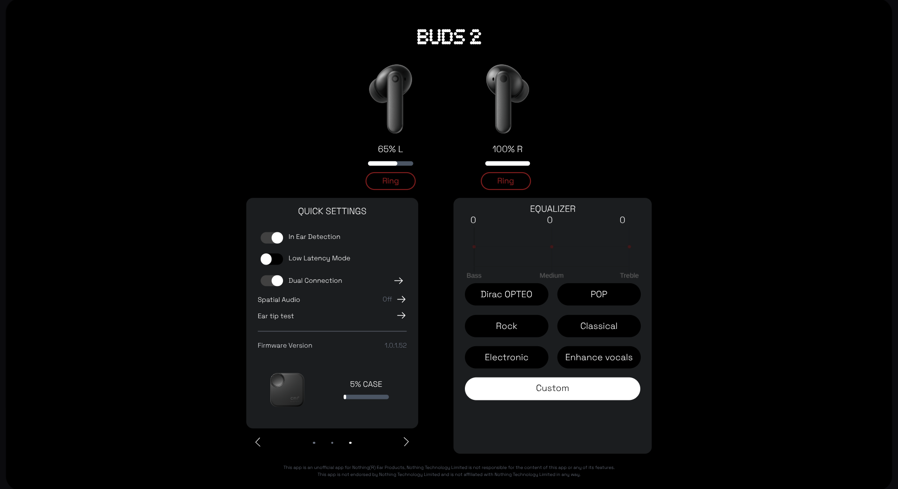

# Ear PC — control your earbuds from your PC (Linux)

This repo ships the **universal Linux installer** for [Ear PC](https://github.com/radiance-project/ear-pc), the unofficial Nothing X port for **Nothing ear(1), ear(2) and ear(stick)** — also works with CMF-style buds. It is unofficial, no affiliation with Nothing.

## Requirements

- Linux x86-64: Debian, Ubuntu, Fedora, Arch, and other apt/dnf/pacman-based distros
- **BlueZ** — the installer adds it via your distro's package manager if missing
  (`apt` on Debian/Ubuntu, `dnf` on Fedora, `pacman` on Arch; on other distros,
  install it manually: Debian/Ubuntu `sudo apt install bluez`, Fedora `sudo dnf install bluez`, Arch `sudo pacman -S bluez`)
- Optional but recommended: any browser the app can use — it runs as an app window (its own Chromium instance) if one is installed, or opens the page in your default browser
- Buds must be paired in your desktop's Bluetooth settings first — the app finds them via `bluetoothctl`

## Install

```bash
git clone https://github.com/GFXOmar/Ear-Pc-Linux.git
cd Ear-Pc-Linux
bash install-ear-pc.sh
```

The installer will:

1. Install `bluez` if `bluetoothctl` is missing (needs `sudo`)
2. Download `ear-pc-linux.tar.xz` from the release:
   https://github.com/GFXOmar/Ear-Pc-Linux/releases/tag/v1.0.6-linux
3. Extract it into `~/.local/share/ear-pc`
4. Create the `ear-pc` launcher in `~/.local/bin` (on your PATH)
5. Create the **Ear PC** entry in your app menu
6. Launch the app

### Installer options

```bash
bash install-ear-pc.sh --help
```

- `--url URL` — use a different tarball URL (default: the release asset above)
- `--no-start` — install without launching the app
- `--app-dir DIR`, `--bin-dir DIR`, `--desktop-dir DIR` — alternate install locations
- Env: `EAR_PC_TARBALL_URL`, `EAR_PC_APP_DIR`, `EAR_PC_BIN_DIR`, `EAR_PC_DESKTOP_DIR`

After installing, run `ear-pc`, or click **Ear PC** in your application launcher.

## What the app does

- **Battery percentage** on tabs and the tray
- **ANC control** — ear(1) and ear(2); Personalized ANC on ear(2)
- **Find my Earbuds**
- **Case battery status LED** (ear(1))
- **Equalizer** — custom equalizer for Ear (stick) and Ear (2)
- **In-Ear Detection, Low Latency Mode, Firmware version**
- **Gestures**

The app has two windows: the **Main Window** and the **Tray Window** (opened from the tray icon).

## Files in this repo

- `install-ear-pc.sh` — the universal installer
- `docs/APP-README.md` — the app's own README (features as shipped upstream)
- Releases: https://github.com/GFXOmar/Ear-Pc-Linux/releases

## Screenshots

### Select device


### UI example 1


### UI example 2

