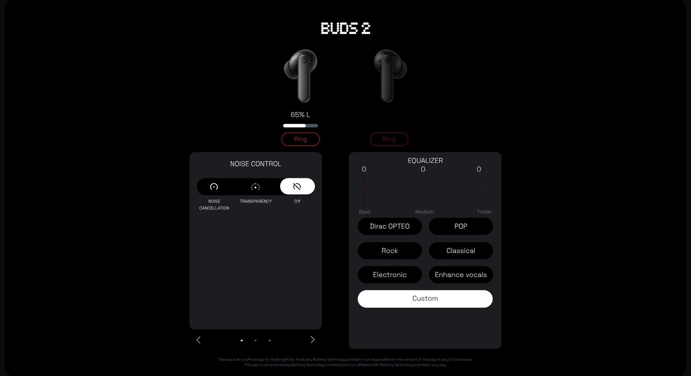

# Ear PC for Linux

<p align="center">
  
</p>

A **universal Linux installer** and packaging of **Ear PC** — an unofficial port of [Nothing X](https://nothing.tech/pages/nothing-x) for PC — so you can control **Nothing** and compatible **CMF** earbuds from Linux.

This project is based on [radiance-project/ear-pc](https://github.com/radiance-project/ear-pc) (Ear PC 1.0.6). The original Windows release shipped its backend as compiled bytecode; this Linux build reconstructs that backend into `main.py`, replaces the abandoned `pybluez` dependency with a pure-Python BlueZ shim (`bluetooth.py`, using native kernel RFCOMM/L2CAP sockets and real SDP channel discovery), and packages everything with a one-command installer that works across major Linux distros.

> **Unofficial project.** Not affiliated with, sponsored by, or endorsed by Nothing Technology Limited or CMF. Use at your own risk — this app communicates with your earbuds over Bluetooth.

---

## Features

- **Battery** — battery percentage for earbuds (and case LED status on ear (1))
- **ANC** — Active Noise Cancellation control (ear (1) & ear (2)); Personalized ANC on ear (2)
- **Equalizer** — presets and custom EQ (Ear (stick) and Ear (2))
- **Gestures** — configure earbud gestures
- **Quick settings** — In-Ear Detection, Low Latency Mode, firmware version, and more
- **Find My Earbuds**
- **Two windows** — Main window and a Tray window for quick access

## Screenshots

### Select device


### 


### 


---

## Supported devices

| Device | Status |
|---|---|
| Nothing ear (1) | Supported (upstream) |
| Nothing ear (stick) | Supported (upstream) |
| Nothing ear (2) | Supported (upstream) |
| CMF buds | May work — reports welcome (not officially verified here) |

Device support comes from the upstream Ear PC protocol implementation. If your model works (or doesn't), please open an issue with your device name and what you see.

## Requirements

- **Linux x86-64** (tested on Arch; intended to work on Debian/Ubuntu, Fedora, and other distros with apt/dnf/pacman)
- **Python 3** with `venv`/`pip` (the installer checks for this)
- **BlueZ** (`bluetoothctl`) — the Bluetooth stack used to discover and talk to the buds
- **A Chromium-based browser** (e.g. `chromium`, `google-chrome`) is recommended; the app runs as a local app window via [Eel](https://github.com/python-eel/Eel). If no Chromium is found it falls back to opening in your default browser.
- **Paired earbuds** — pair your Nothing/CMF buds in your system Bluetooth settings before using the app

## Install

```bash
git clone https://github.com/GFXOmar/Ear-Pc-Linux.git
cd Ear-Pc-Linux
bash install-ear-pc.sh
```

### What the installer does

1. Detects your distro family and installs **BlueZ** if `bluetoothctl` is missing (may prompt for `sudo`): `apt` on Debian/Ubuntu, `dnf` on Fedora/RHEL-family, `pacman` on Arch-family.
2. Downloads the packaged app tarball from the [latest release](https://github.com/GFXOmar/Ear-Pc-Linux/releases/latest) (`EAR_PC_TARBALL_URL` can override the source).
3. Extracts the app to `~/.local/share/ear-pc` (default).
4. Creates a Python virtual environment and installs dependencies from `requirements.txt`.
5. Installs a launcher script at `~/.local/bin/ear-pc`.
6. Installs a desktop entry at `~/.local/share/applications/ear-pc.desktop` ("Ear PC").
7. Launches the app (unless `--no-start` is passed).

### Installer options

```bash
bash install-ear-pc.sh [options]
```

| Option / env var | Default | Description |
|---|---|---|
| `--url URL` / `EAR_PC_TARBALL_URL` | release asset URL | Tarball URL or local `file://` path to install from |
| `--app-dir DIR` / `EAR_PC_APP_DIR` | `~/.local/share/ear-pc` | App install directory |
| `--bin-dir DIR` / `EAR_PC_BIN_DIR` | `~/.local/bin` | Where the `ear-pc` launcher is placed |
| `--desktop-dir DIR` / `EAR_PC_DESKTOP_DIR` | `~/.local/share/applications` | Where the `.desktop` entry is placed |
| `--no-start` | off | Install only, don't launch |

Make sure `~/.local/bin` is on your `PATH` so you can run `ear-pc` from a terminal.

## Usage

- **App menu:** search for **Ear PC**
- **Terminal:** run `ear-pc`

The app serves a local UI at `http://localhost:17079` and opens it in an app window (Chromium app mode when available). It uses its own browser profile at `~/.local/share/ear-pc/.chromium-profile`, so it won't interfere with your normal browser session.

For verbose logs (useful when reporting issues):
```bash
EARPC_VERBOSE=1 ear-pc
```

## Uninstall

```bash
rm -rf ~/.local/share/ear-pc
rm -f ~/.local/bin/ear-pc
rm -f ~/.local/share/applications/ear-pc.desktop
```

This removes the app, its virtual environment, local profile/database, launcher, and desktop entry.

## Troubleshooting

- **App can't find your earbuds**
  - Make sure the buds are **paired and connected** in your system Bluetooth settings first.
  - Ensure the Bluetooth service is running: `systemctl status bluetooth` (start/enable it if needed: `sudo systemctl enable --now bluetooth`).
  - Try toggling Bluetooth off/on or re-pairing the device.
  - Run with `EARPC_VERBOSE=1 ear-pc` to see discovery/connection logs.
- **`bluetoothctl` missing / BlueZ not installed** — run the installer again (it installs BlueZ on apt/dnf/pacman distros) or install BlueZ manually for your distro.
- **`~/.local/bin` not on PATH** — add it to your shell profile (e.g. `export PATH="$HOME/.local/bin:$PATH"` in `~/.bashrc` or `~/.profile`) or launch via the full path/desktop entry.
- **Blank window or browser issues** — install a Chromium-based browser; the app prefers Chromium app mode. If it falls back to a regular browser tab, make sure nothing else is using port `17079`.
- **CMF device not detected/working** — CMF support is unverified here; please open an issue with your exact model and verbose logs so it can be investigated.

## Repository contents

- `install-ear-pc.sh` — universal installer script
- `ss/` — screenshots used in this README
- `docs/APP-README.md` — README shipped with the packaged Linux app/build
- [Releases](https://github.com/GFXOmar/Ear-Pc-Linux/releases) — packaged app tarball (`ear-pc-linux.tar.xz`)

## Credits & acknowledgements

- **[radiance-project/ear-pc](https://github.com/radiance-project/ear-pc)** — the original Ear (PC) project and UI/frontend this is based on (unofficial Nothing X port, Ear PC 1.0.6). Huge credit to the upstream authors:
  - **RapidZapper** — idea and backend work
  - **[Bendix](https://www.mrbrickstar.de/)** — frontend work
  - **[DerrenGoneDigital](https://twitter.com/DerrenDigital)** — logo
- **[radiance-project/ear-web](https://github.com/radiance-project/ear-web)** — the Radiance Project's multiplatform web successor to Ear (PC), by the same team. A great browser-based option (Chromium + Web Bluetooth) if you prefer not to install a native app; it also supports newer devices such as CMF Buds Pro/Pro 2 and Nothing Ear.
- **[GFXOmar](https://github.com/GFXOmar)** — Linux port/packaging and this universal installer (backend reconstruction for Linux, pure-Python BlueZ shim, distro-friendly installer and distribution).

This repo packages and distributes a Linux build derived from Ear PC 1.0.6; see the upstream projects for their full history and credits.

## Privacy & security

- The app runs **locally**: it serves its UI on `localhost` and communicates with your earbuds over your local Bluetooth connection.
- No accounts, cloud services, or telemetry are added by this installer/repo.
- As with any tool that talks to device firmware over Bluetooth, review the source/behavior and use it at your own discretion.

## Contributing / issues

Bug reports and device compatibility reports are welcome — especially for CMF models. When opening an issue, please include:

- Your Linux distro and version
- Earbud model (Nothing ear (1)/(2)/(stick), CMF model, etc.)
- How you installed (installer options if any)
- Steps to reproduce and what you expected vs. what happened
- Relevant logs: run with `EARPC_VERBOSE=1 ear-pc` and include the output (remove anything sensitive)

Pull requests that improve Linux compatibility, packaging, or documentation are appreciated.

## Disclaimer

This is an independent, unofficial project and is **not** affiliated with, endorsed by, or connected to Nothing Technology Limited, CMF, or the radiance-project maintainers. “Nothing”, “CMF”, and related marks are the property of their respective owners. The software is provided as-is, without warranty; interacting with earbuds/firmware is done at your own risk.

## License

This project is licensed under the **GNU Affero General Public License v3.0 (AGPL-3.0)** — see [LICENSE](LICENSE).

The upstream [radiance-project/ear-pc](https://github.com/radiance-project/ear-pc) is published under the GNU General Public License v3.0; this Linux packaging/build and accompanying materials are distributed under AGPL-3.0. Content, logos, and trademarks referenced from Nothing Technology remain the property of their respective owners (see upstream legal notes).
